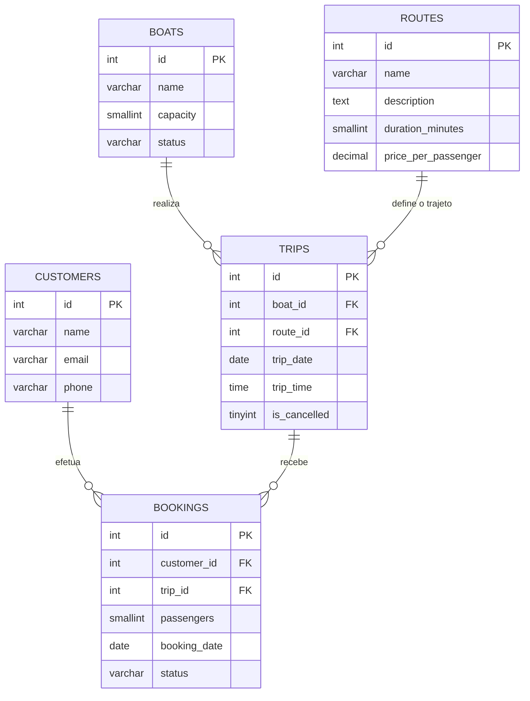

# Modelo relacional da RiaTour

A base `bdRiaTour_NomeConcorrente_C27` usa cinco tabelas InnoDB. Cada passeio é um horário de partida com um barco e um percurso. Cada reserva liga um cliente a um passeio.

## Chaves e restrições

As chaves primárias usam inteiros sem sinal e são geradas pelo MySQL. As chaves estrangeiras são obrigatórias e impedem eliminar um barco, percurso, cliente ou passeio enquanto for referenciado. Os nomes e contactos são texto obrigatório. O telefone é texto para guardar prefixos e zeros iniciais. A duração é um inteiro positivo em minutos. O preço usa `DECIMAL(8,2)` e deve ser positivo. A capacidade e o número de passageiros também são inteiros positivos. A data de reserva indica quando a reserva foi efetuada. A data e a hora do passeio indicam a partida.

| Entidade | Estados | Representação |
| --- | --- | --- |
| Barco | ativo, inativo | `boats.status`, por defeito ativo. |
| Passeio | disponível, esgotado, cancelado | `trip_availability.status`, calculado. `trips.is_cancelled` guarda a decisão de cancelar. |
| Reserva | pendente, confirmada, cancelada | `bookings.status`, por defeito pendente. |

## Lotação e estado do passeio

Os lugares ocupados são a soma de `bookings.passengers` das reservas **pendentes e confirmadas** daquele passeio. Esta é a regra adotada para o projeto. As reservas canceladas libertam lugares. A vista `trip_availability` calcula a soma com `SUM` e devolve zero para passeios sem reservas que ocupem lugares. Os lugares livres são a capacidade do barco associado menos essa soma.

1. Se `is_cancelled = 1`, o passeio fica **cancelado**.
2. Nos restantes passeios, se o total atingiu ou ultrapassou a capacidade, o estado é **esgotado**.
3. Se ainda houver lugares, o estado é **disponível**.

O resultado acompanha imediatamente as alterações às reservas, a troca de barco e as mudanças de capacidade. Por exemplo, se um passeio de 10 lugares tiver 7 passageiros confirmados e 3 pendentes, está esgotado. Ao cancelar a reserva pendente, fica disponível com 3 lugares livres. A inatividade do barco é um estado próprio e o cancelamento do passeio é registado separadamente.

**Limite da implementação.** A vista calcula o estado e as restrições SQL verificam os valores de cada registo e as referências. Uma alteração manual por SQL ainda pode exceder a lotação. A prevenção de sobrelotação é uma validação do M3. Na gravação, o M3 deve bloquear os registos relevantes numa transação, recalcular a ocupação e rejeitar a alteração se o novo total ultrapassar a capacidade. Na edição de uma reserva, a soma deve excluir a versão anterior da própria reserva. Uma mudança de passeio, de estado, de barco ou uma redução de capacidade tem de respeitar a mesma regra. A aplicação deve também validar a data de um passeio no momento de o agendar.

[Definição SQL](../database/01_schema.sql) · [Importar, testar e exportar](05-CABULA-SQL.md)
