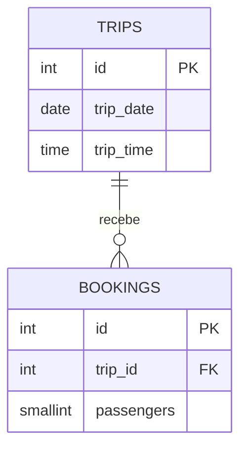
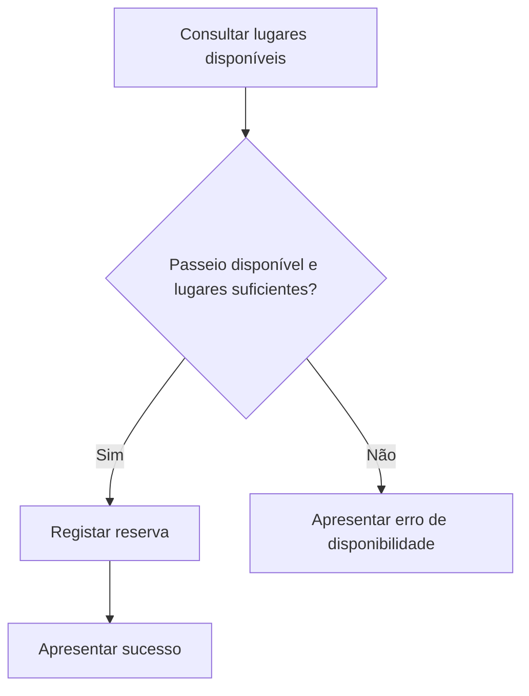

# Cábula de diagramas — RiaTour

## Exemplo de diagrama ER

Cada reserva pertence a um único passeio. Um passeio pode existir sem reservas ou ter várias. Guardar a chave estrangeira na tabela que representa o lado «muitos».

**Adaptar a outro negócio.** Identificar as entidades que têm dados próprios, rever quem pode existir sem o outro e confirmar se a relação é de um-para-muitos ou de muitos-para-muitos. Ver o [modelo completo do Módulo 1](04-MODELO-ER.md).

## Exemplo de caso de uso

**Operador — Consultar reservas.** O operador abre a gestão de reservas, pesquisa por cliente, passeio ou estado e consulta o registo pretendido. No diagrama, ligar o ator à elipse «Consultar reservas», dentro da fronteira do sistema.

O [diagrama editável](../design/casos-de-uso.svg) contém os sete casos do Operador e os três do Cliente. Os casos do Cliente fazem parte da análise funcional do Módulo 2. A aplicação prevista para o Módulo 3 centra-se nas interfaces de gestão do Operador.

**Adaptar a outro negócio.** Nomear os papéis que interagem com o sistema e usar verbos que descrevam o que cada ator pretende realizar.

## Exemplo de fluxograma

O [fluxograma completo](../design/fluxograma-reserva.svg) começa pela escolha do passeio, pela seleção ou inserção de cliente e pela indicação do número de passageiros. Usa retângulos para ações, losangos para decisões e setas rotuladas para os ramos.

**Adaptar a outro negócio.** Identificar as condições que impedem a gravação e escrever o que acontece em cada ramo. Na RiaTour, oito lugares ocupados num barco de dez deixam dois disponíveis. Um pedido de dois pode avançar. Um pedido de três segue para o erro.

## Exemplo de wireframe

No [wireframe de reservas](../design/wireframe-reservas.svg), a navegação abre a área de gestão, os filtros restringem a listagem e as ações por linha permitem ver, editar, eliminar ou alterar o estado. O formulário e as mensagens mostram exemplos dos estados do ecrã.

| Zona | Conteúdo |
| --- | --- |
| Navbar | Início, Barcos, Percursos, Passeios, Clientes e Reservas. |
| Pesquisa | Cliente, passeio e estado. |
| Tabela | Cliente, percurso, barco, data e hora do passeio, número de passageiros, estado e ações. |
| Formulário | Cliente, passeio, passageiros, data da reserva e estado. |
| Feedback | Sucesso ao gravar, erro de disponibilidade e confirmação de eliminação. |

**Adaptar a outro negócio.** Conservar a ordem de navegação, pesquisa, listagem e edição. Substituir colunas, filtros, campos e mensagens pelos que o operador usa na tarefa.

[Dashboard](../design/wireframe-dashboard.svg) · [Barcos](../design/wireframe-barcos.svg) · [Percursos](../design/wireframe-percursos.svg) · [Horários / Passeios](../design/wireframe-passeios.svg) · [Reservas](../design/wireframe-reservas.svg) · [Clientes](../design/wireframe-clientes.svg)

Os SVG são ficheiros editáveis num editor vetorial ou de texto. Os três PDFs para entrega estão em [output/pdf](../output/pdf/).
